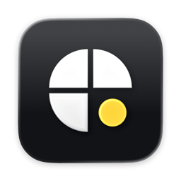
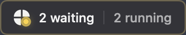
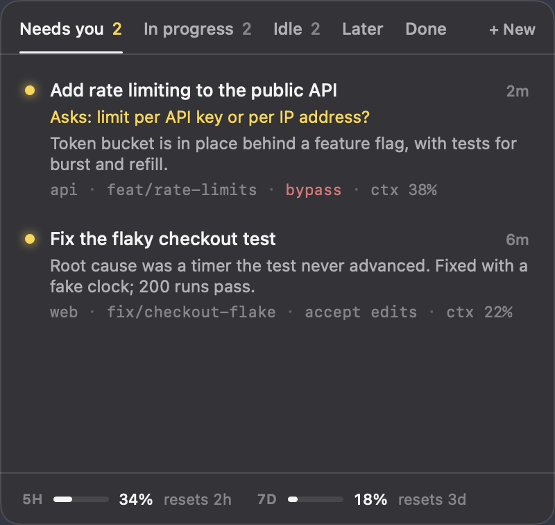
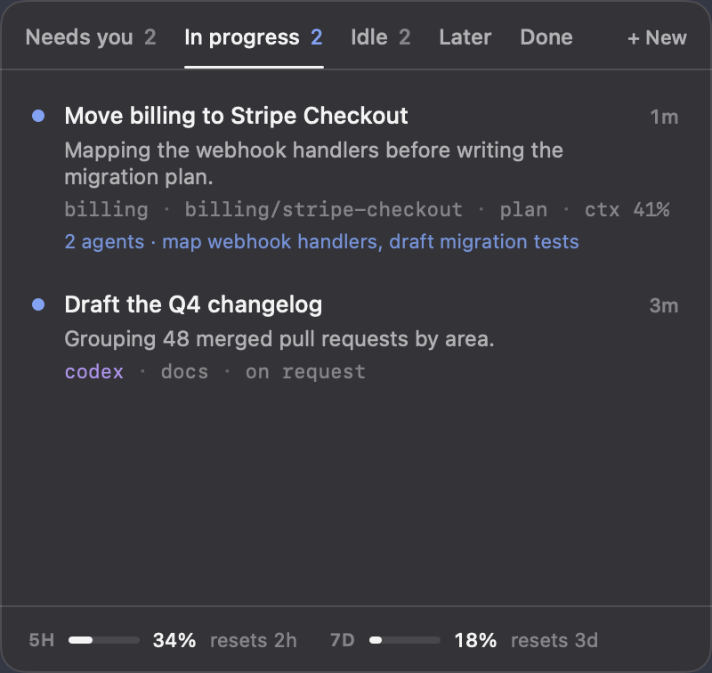
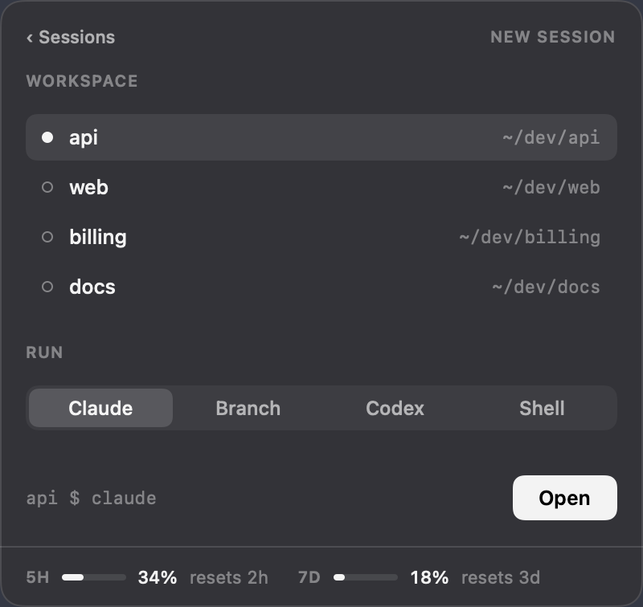
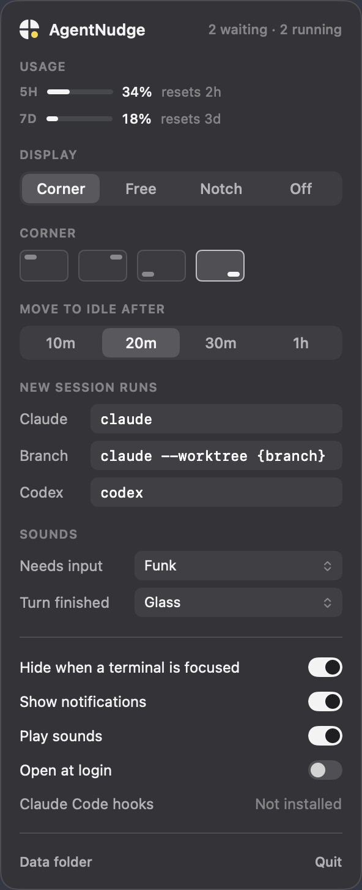
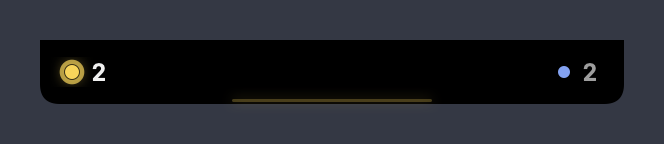

<p align="center">
  
</p>

<h1 align="center">AgentNudge</h1>

<p align="center">
  A small macOS indicator that tells you which of your Claude Code and Codex sessions need you,<br>
  without changing how you use your terminal.
</p>

<p align="center">
  
</p>

You run several coding agents in several terminal tabs. Most of the time you don't
need to watch them; you need to know when one has finished or is asking you something.
AgentNudge sits in a corner of the screen (or around the notch) and tells you exactly
that. Click it for the list, click a session to jump to its terminal tab.

<p align="center">
  
  
</p>

## What it does

- **Tells you who needs you.** A session that just finished its turn, or is waiting
  on a question, a plan approval or a permission prompt, lands in **Needs you**. The
  tray pulses until you've dealt with it. After 20 minutes without a reply (you can
  change this), it moves to **Idle**.
- **Shows what each session is doing**: its title, Claude Code's latest recap or last
  reply, the project and branch, the permission mode (bypass, plan, auto, accept
  edits, ask), how much of the context window is used, and the subagents still running.
- **Jumps to the exact tab.** In Ghostty, clicking a session focuses the very tab or
  split it runs in, found through the session's own terminal. Other terminals (Terminal, iTerm2, Warp, kitty, the VS Code terminal) are
  brought to the front.
- **Starts new sessions.** Pick a workspace and run Claude, a session on a new
  branch, Codex, or a plain shell in a new Ghostty tab. A branch name on your
  clipboard is filled in for you.
- **Shows your plan usage**: the 5-hour and 7-day windows, and when each resets.
- **Reads Codex too**: threads from the Codex app and CLI that were active in the
  last day, with the same sorting.
- **Stays out of the way.** It hides while a terminal is in front, takes no Dock
  space, and is about 1 MB of native AppKit and SwiftUI.

<p align="center">
  
  
</p>

The menu bar icon opens Settings. Its light shows the state at a glance: none when
all is quiet, small while sessions run, full when one needs you.

On a Mac with a notch, choose **Notch** in Settings: what needs you sits left of the notch and
what's running sits right of it. Each side is sized to the free menu bar space next to the
notch and left out when there is none, so it never covers your menus or menu bar icons:

<p align="center">
  
</p>

## Install

### Let your agent set it up

Paste this into Claude Code or Codex:

```text
Install AgentNudge on this Mac for me: https://github.com/nickViduya/agentnudge

1. Check that this Mac runs macOS 14 or later and has Xcode or its command line
   tools (`xcrun swiftc --version`). If `jq` is missing, install it with Homebrew.
2. Clone the repo into the folder where I keep code (ask me if unsure) and run
   ./scripts/build.sh from it.
3. Quit AgentNudge if it is running, copy build/AgentNudge.app to /Applications,
   and open it.
4. Run ./scripts/install-hooks.sh, which adds AgentNudge's hooks to
   ~/.claude/settings.json and keeps a backup. Show me what changed.
5. For the usage meters: if ~/.claude/settings.json has a statusLine command that
   runs a script, add this line right after the script reads its JSON input from
   stdin (rename $input to whatever variable holds it):
     h="$HOME/.agentnudge/bin/agentnudge-hook"; [ -x "$h" ] && { printf '%s' "$input" | "$h" StatusLine >/dev/null 2>&1 & }
   Back the script up first, then check the status line still prints the same.
   If I have no status line, skip this and tell me the meters will stay hidden.
6. Ask me which commands I use to start a Claude Code session, a session on a new
   branch, and Codex; I may use shell aliases. Quit AgentNudge, set claudeCommand,
   branchCommand (with {branch} where the branch name goes) and codexCommand in
   ~/.agentnudge/state.json without touching its other keys, then open it again.
7. Finally, tell me that sessions already open pick up the hooks once restarted,
   and that the first click on a session asks me to let AgentNudge control Ghostty.
```

### By hand

```sh
git clone https://github.com/nickViduya/agentnudge.git
cd agentnudge
./scripts/build.sh                    # builds build/AgentNudge.app and a DMG
cp -R build/AgentNudge.app /Applications/
open /Applications/AgentNudge.app
./scripts/install-hooks.sh            # optional, see below
```

You need macOS 14 or later, Xcode or its command line tools, and `jq` for the hook
installer. Xcode 26 compiles the Liquid Glass app icon; without it the app builds
with a generic icon.

The hooks are optional but recommended: without them AgentNudge still sees every
session and whether it is working or finished; with them it also knows the moment a
session asks a question, waits on a plan approval or a permission prompt, and its
live permission mode. `./scripts/install-hooks.sh --uninstall` removes them.

For the usage meters, add the one line from step 5 above to your status line script.

## How it works

AgentNudge only reads files on your Mac. Nothing leaves it.

- **Claude Code** keeps a list of its running sessions in `~/.claude/sessions`, with
  whether each is busy or idle. Each session's transcript in `~/.claude/projects`
  gives its title, recap, permission mode, branch and running subagents.
- **The hooks** call `~/.agentnudge/bin/agentnudge-hook`, a tiny helper that writes the
  session's latest state to `~/.agentnudge/hooks/`. It never prints anything and always
  exits 0, so it can't block or steer Claude. Claude Code reads hooks when a session
  starts, so sessions that were already open pick them up after a restart.
- **The status line** line passes Claude Code's status JSON to the same helper, which
  keeps the plan usage and each session's context use.
- **Codex** keeps its threads in `~/.codex/state_*.sqlite` and a rollout file per
  thread; AgentNudge reads both, read-only.
- **Ghostty** (1.3 or later) is driven through its AppleScript dictionary to find and
  focus a session's tab and to open new ones. macOS asks once for permission.

### How sessions are sorted

- **Needs you**: finished its turn less than 20 minutes ago, or waiting on a question,
  a plan approval or a permission prompt. Opening it doesn't clear it; a new turn or
  the time limit does.
- **In progress**: working.
- **Idle**: finished more than 20 minutes ago with nothing from you since. A session
  whose only activity is a background command that went quiet also lands here.
- **Later** and **Done**: your own sorting. Neither closes anything, and either one
  lasts until the session does something new. A session you exit goes to Done for a day.

Settings and your choices live in `~/.agentnudge/state.json`.

## Scripting

```sh
open agentnudge://list                          # open the session list
open agentnudge://new                           # open the launcher
open agentnudge://settings
open agentnudge://close
open agentnudge://snooze                        # hide the indicator for an hour
open "agentnudge://open?id=<session id>"        # jump to a session's tab
```

These only show AgentNudge's own windows or focus a session that is already running.
Any web page can open a URL like these, so none of them starts a session or runs a
command; that always takes a click in the launcher.

## Development

```sh
./scripts/build.sh                              # app and DMG in build/
build/AgentNudge.app/Contents/MacOS/AgentNudge --snapshot /tmp/shots --demo
```

`--snapshot` renders the indicators, the list, the launcher and Settings to PNG
files, which is how the screenshots here were made. `--demo` uses sample sessions
instead of the ones on your Mac.

The app is signed ad hoc, which is enough to run it on your own Mac. A build you hand
to other people needs a Developer ID signature and notarization.

## License

MIT. See [LICENSE](LICENSE).
